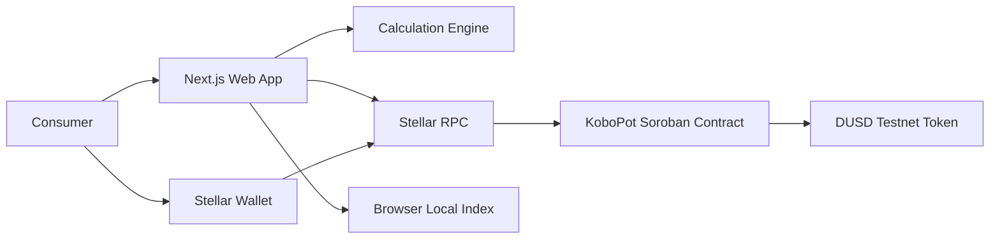
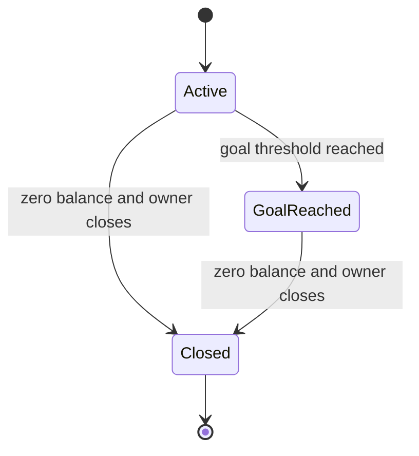
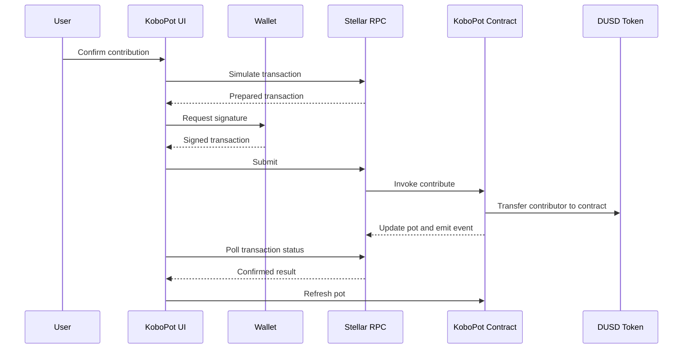
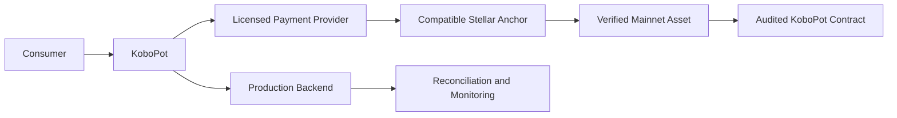

# KoboPot Complete Project Bible

**Project:** KoboPot  
**Tagline:** Spend normally. Save little by little.  
**Platform:** Stellar Testnet and Soroban  
**Document purpose:** Complete product, engineering, design, security, testing, deployment, demonstration, submission, and Mainnet migration guide.

> **New-project directive:** KoboPot is a completely new project. It must be built from scratch and must not reuse ClaimCheque, StellarCheque, or any previous digital-cheque project architecture, contracts, routes, storage models, naming, or product copy.

> **Sandbox notice:** KoboPot is currently a Stellar Testnet demonstration. Mobile Money purchases and exchange rates are simulated. DUSD is a Testnet demonstration token with no real monetary value.

---

## How to Use This Bible

Give this single file to Cursor Agent and use the instruction below:

```text
Read @KoboPot_Complete_Project_Bible.md from beginning to end.

Treat KoboPot as a completely new project. Create TODO.md from the acceptance criteria, initialize the project from scratch, and implement the complete sandbox MVP.

Do not stop after scaffolding, UI generation, or local mocks. Implement and validate the Soroban contract, contract tests, DUSD Testnet flow, Next.js frontend, Stellar wallet integration, pot creation, simulated purchase calculation, contribution, dashboard, withdrawal, deployment scripts, CI, documentation, and production build.

Use Stellar Testnet only. Clearly label simulated Mobile Money purchases, the demonstration exchange rate, and DUSD as sandbox components with no real monetary value.

Run all contract tests, frontend tests, linting, type-checking, contract builds, and frontend production builds. Fix failures instead of merely describing them. Never fabricate contract IDs, token IDs, transaction hashes, deployment results, test results, screenshots, team activity, or commit links.

Continue until every acceptance criterion in the project bible passes or an external credential or unavailable network service is the only remaining blocker.
```

---

## Contents

1. Cursor Agent Start Here
2. Master Build Prompt
3. Product Requirements
4. Development Bible
5. Soroban Contract Specification
6. Frontend and UX Specification
7. Testing, QA, and Security Plan
8. Testnet Deployment Runbook
9. Demo and Submission Guide
10. Mainnet Migration Bible
11. Today’s Execution Plan

---


---

## KoboPot: Cursor Agent Start Here

## New Project Directive

This is a completely new project named **KoboPot**.

Build it from scratch in this repository. Do not reuse ClaimCheque, StellarCheque, digital-cheque code, routes, contracts, copy, storage models, or branding. If the repository contains unrelated files, inspect them before changing anything. Preserve only generic tooling that clearly benefits KoboPot.

## Mission

Build a polished Stellar Testnet consumer-savings sandbox where a user:

1. Connects a Stellar wallet.
2. Creates a personal savings pot.
3. Chooses a fixed-saving or round-up rule.
4. Records a simulated Mobile Money purchase.
5. Reviews the calculated saving and simulated exchange rate.
6. Approves a Testnet DUSD contribution.
7. Sees the contribution enter Soroban contract custody.
8. Tracks progress toward a goal.
9. Withdraws when the pot rules permit.

## Read These Files in Order

1. `00_CURSOR_START_HERE.md`
2. `01_MASTER_BUILD_PROMPT.md`
3. `02_PRODUCT_REQUIREMENTS.md`
4. `03_DEVELOPMENT_BIBLE.md`
5. `04_CONTRACT_SPEC.md`
6. `05_FRONTEND_UX_SPEC.md`
7. `06_TESTING_QA_SECURITY.md`
8. `07_DEPLOYMENT_RUNBOOK.md`
9. `08_DEMO_AND_SUBMISSION.md`
10. `09_MAINNET_MIGRATION.md`
11. `10_TODAY_EXECUTION_PLAN.md`

## Cursor Agent Command

Use this exact instruction:

```text
Read every KoboPot Markdown file in numerical order, beginning with @00_CURSOR_START_HERE.md.

Treat KoboPot as a completely new project. Create TODO.md from the acceptance criteria, initialize the monorepo, and implement the project from scratch.

Do not stop after scaffolding, UI generation, or local mocks. Implement and validate the Soroban contract, contract tests, Testnet token flow, Next.js frontend, Stellar wallet integration, contribution flow, withdrawal flow, deployment scripts, CI, documentation, and production build.

Use Stellar Testnet only. Simulated Mobile Money purchases, the demonstration exchange rate, and DUSD must be clearly labelled as sandbox data with no real monetary value.

Run every required test, lint, type-check, contract build, and frontend production build. Fix failures rather than merely documenting them. Never fabricate contract IDs, token IDs, transaction hashes, deployments, test results, screenshots, or team contributions.

Continue until all acceptance criteria pass or an external credential or unavailable network service is the only remaining blocker.
```

## Required Final Report

Cursor must finish by reporting:

- Files created and changed
- Architecture implemented
- Commands run and their results
- Contract test results
- Frontend lint, type-check, test, and build results
- Testnet deployment status
- Genuine contract ID, token ID, and transaction hashes, only if actually produced
- Remaining blockers
- Exact live-demo steps
- Sandbox limitations
- Recommended next action


---

## KoboPot Master Build Prompt

## Role

Act as a senior full-stack engineer, Stellar engineer, Rust smart-contract engineer, product designer, security reviewer, QA lead, DevOps engineer, and technical writer.

Build **KoboPot**, a new mobile-first consumer savings sandbox on Stellar Testnet.

## Product Identity

- **Name:** KoboPot
- **Tagline:** Spend normally. Save little by little.
- **Promise:** Turn everyday spending into an everyday savings habit.
- **Primary audience:** Students, young workers, traders, gig workers, and frequent Mobile Money users.

## Honest MVP Positioning

The MVP does not monitor or debit real Mobile Money accounts. A user manually records or simulates a purchase. KoboPot calculates a saving and asks the user to approve a Testnet token contribution.

Always display:

> KoboPot is a Stellar Testnet demonstration. Mobile Money purchases and exchange rates are simulated. DUSD has no real monetary value.

## Required End-to-End Flow

```text
Connect Testnet wallet
→ create pot
→ define goal and saving rule
→ simulate purchase
→ calculate saving in minor units
→ convert with a simulated rate
→ approve contribution
→ transfer DUSD to Soroban custody
→ refresh on-chain pot state
→ show progress and explorer link
→ owner withdraws when eligible
```

## Technology

- Monorepo using npm workspaces or pnpm
- Next.js App Router
- React and strict TypeScript
- Tailwind CSS
- Zod
- React Hook Form where useful
- Current official Stellar JavaScript SDK and RPC APIs
- Stellar Wallets Kit when compatible, with Freighter as minimum wallet support
- Rust Soroban contract
- Current mutually compatible `soroban-sdk` and Stellar CLI
- Vitest for pure frontend utilities
- Rust unit tests for the contract
- GitHub Actions CI

Use current compatible package versions. Inspect documentation and installed type definitions before using uncertain APIs.

## Repository

```text
kobopot/
├── apps/web/
│   ├── app/
│   ├── components/
│   ├── hooks/
│   ├── lib/contract/
│   ├── lib/savings/
│   ├── lib/stellar/
│   ├── lib/storage/
│   ├── lib/validation/
│   ├── tests/
│   └── .env.example
├── contracts/kobopot/src/
├── scripts/
├── docs/
├── .github/workflows/ci.yml
├── Cargo.toml
├── package.json
├── README.md
├── STELLAR14_PROGRESS.md
└── TODO.md
```

## Core On-Chain Functions

```text
create_pot(owner, token, goal_amount, unlock_at) -> pot_id
get_pot(pot_id) -> SavingsPot
contribute(pot_id, contributor, amount, reference_hash) -> SavingsPot
withdraw(pot_id, owner, amount) -> SavingsPot
close_pot(pot_id, owner) -> SavingsPot
```

## Core Contract Rules

- Owner authorizes pot creation.
- Contributor authorizes each contribution.
- Only the owner can withdraw or close.
- Contributions transfer exact token value into contract custody.
- Withdrawal destination is always the stored owner.
- Duplicate contribution references for the same pot fail.
- Locked pots cannot be withdrawn before unlock time.
- Closed pots cannot receive contributions.
- A pot can close only at zero balance.
- No admin withdrawal or arbitrary transfer method.
- State updates and token transfers are atomic.
- Use checked arithmetic.
- Extend storage TTL on relevant reads and writes.

## Frontend Routes

- `/` landing
- `/onboarding`
- `/pot/new`
- `/dashboard`
- `/pot/[id]`
- `/purchase`
- `/withdraw`

## Core UI States

- Wallet disconnected
- Wallet unavailable
- Preparing transaction
- Awaiting signature
- Submitting
- Confirming
- Success
- Contract rejection
- Network failure
- Timeout

## Sandbox Asset

Use a Testnet token called **Demo USD**, symbol **DUSD**, when practical. It has no monetary value. Prefer standard documented token tooling over writing a custom token contract.

## Required Documentation Generated by the Project

- Complete README
- Architecture with Mermaid diagrams
- Contract specification
- Sandbox limitations
- Deployment runbook
- Demo script
- Mainnet migration plan
- Stellar 14 progress file with truthful placeholders

## Acceptance Criteria

- New KoboPot project, no cheque naming remains
- Rust formatting, tests, lint where applicable, and contract build pass
- Frontend lint, type-check, tests, and production build pass
- Wallet connects on Testnet
- Pot creation succeeds
- Fixed and round-up calculations are correct
- Contribution transfers exact DUSD amount into contract custody
- Chain state updates the dashboard
- Duplicate reference fails
- Non-owner withdrawal fails
- Pre-unlock withdrawal fails
- Eligible withdrawal succeeds
- Explorer links target Testnet
- Sandbox notices are visible
- No secrets are committed
- README commands are reproducible

## Execution Order

1. Inspect repository and create `TODO.md`.
2. Initialize monorepo.
3. Implement and test contract first.
4. Implement decimal-safe calculation utilities and tests.
5. Implement Stellar integration layer.
6. Build wallet, pot creation, purchase, contribution, dashboard, and withdrawal flows.
7. Add deployment scripts and Testnet token setup.
8. Run full validation and fix every failure.
9. Complete documentation.
10. Deploy to Testnet if environment permits.
11. Produce final report.

## Do Not Build Yet

- Real MoMo automation
- SMS scraping
- Mainnet
- Real USDC claims
- KYC system
- Custom anchor
- Yield, lending, or investment features
- Complex analytics
- Multiple fiat currencies


---

## KoboPot Product Requirements

## Problem

People make many small everyday Mobile Money payments but often struggle to save a large amount at once. KoboPot connects saving to an existing habit by prompting the user to add a small, manageable amount to a personal savings pot after a recorded purchase.

## Solution

KoboPot is a consumer savings sandbox that calculates either a fixed contribution or a round-up amount and deposits the equivalent Testnet token into a user-owned Soroban savings pot.

## Personas

### Ama, Student

Saves small amounts toward a laptop after airtime, food, and transport purchases.

### Kojo, Gig Worker

Uses a fixed contribution to build an emergency buffer despite irregular income.

### Esi, Trader

Saves toward business stock using frequent small contributions.

## Jobs to Be Done

- Help me begin saving without waiting for a large surplus.
- Show clear progress toward a goal.
- Keep withdrawal control attached to my wallet.
- Explain what happens without blockchain jargon.
- Make the sandbox limitations obvious.

## User Stories

- As a user, I can connect a Testnet wallet.
- As a user, I can create multiple savings pots.
- As a user, I can select a fixed or round-up rule.
- As a user, I can record a simulated purchase.
- As a user, I can review the saving before approval.
- As a user, I can add Testnet tokens to my pot.
- As a user, I can see my on-chain balance and progress.
- As an owner, I can withdraw when eligible.
- As an owner, I can close a zero-balance pot.

## Savings Rules

### Fixed

The configured amount is saved after each recorded purchase.

### Round Up

Round purchase amount `P` to interval `I`:

```text
saving = (ceil(P / I) × I) - P
```

Sandbox rule for exact multiples: save one full interval.

```text
GHS 17 with interval GHS 5 → GHS 3
GHS 10 with interval GHS 5 → GHS 5
```

Use integer pesewas and bigint-safe conversions.

## Functional Scope

- Wallet connection
- Pot creation
- Savings-rule configuration
- Purchase simulation
- Demonstration rate conversion
- Token contribution
- Goal progress
- Pot details
- Contribution reference deduplication
- Owner withdrawal
- Optional lock timestamp
- Pot closure
- Explorer links

## Out of Scope

- Automatic MoMo detection
- Real customer money
- Mainnet
- Real-time exchange market
- Investment returns
- Interest
- KYC
- Banking integration
- Production custody

## Success Measures

- Demo completed in under two minutes
- User understands simulated versus real components
- Contract invariant remains valid
- Unauthorized money movement fails
- App builds from documented instructions


---

## KoboPot Development Bible

This document is the single source of truth for product, engineering, security, UX, delivery, and future migration decisions.

## 1. Product Doctrine

KoboPot is a savings-habit product, not a crypto trading application. The consumer should understand goals, contributions, progress, and withdrawals before seeing technical transaction details.

### Principles

1. **Honesty first:** clearly separate simulated Mobile Money activity from real Testnet operations.
2. **User control:** every sandbox contribution requires wallet approval.
3. **No hidden custody:** only the pot owner can withdraw.
4. **Small, complete MVP:** a working contribution is more valuable than many unfinished screens.
5. **Chain as source of truth:** local storage improves navigation but never proves balances.
6. **Safe language:** avoid bank, deposit protection, guaranteed return, and inflation-protection claims.

## 2. System Architecture



### Trust Boundaries

- Browser handles simulated purchase data and display metadata.
- Wallet controls transaction authorization.
- Contract controls pot accounting and token custody.
- Token contract controls balances and transfers.
- Local storage is untrusted convenience data.

## 3. Domain Model

### SavingsPot

- `id`
- `owner`
- `token`
- `goal_amount`
- `balance`
- `total_deposited`
- `total_withdrawn`
- `contribution_count`
- `created_at`
- `unlock_at`
- `status`

### PotStatus

- `Active`
- `GoalReached`
- `Closed`

### Off-Chain Pot Metadata

- Goal name
- Goal category
- Note
- Saving rule
- Fixed amount or interval
- GHS display goal

### Simulated Purchase

- Category
- Description
- GHS amount in pesewas
- Timestamp
- Local transaction reference
- Calculated saving
- Demonstration rate
- DUSD base-unit amount
- Confirmed Stellar transaction hash, if successful

## 4. State Machine



GoalReached remains contributable for the MVP. Withdrawal may return the available balance below the goal without reverting status. Document this simplified behavior. A later version may separate lifecycle status from goal-achievement history.

## 5. Accounting Model

Required invariant:

```text
balance = total_deposited - total_withdrawn
```

Every contribution must:

1. Confirm valid pot status.
2. Confirm unused reference.
3. Require contributor authorization.
4. Transfer exact tokens to contract.
5. Update accounting.
6. Mark reference processed.
7. Emit event.

Every withdrawal must:

1. Require owner authorization.
2. Check lock and balance.
3. Update accounting.
4. Transfer exact amount to owner.
5. Emit event.

Soroban transaction atomicity means failure must revert the complete operation.

## 6. ID and Reference Strategy

### Pot ID

Generate a deterministic collision-resistant hash from:

- Contract address
- Owner
- Token
- Owner nonce
- Goal amount
- Ledger context where safe

### Contribution Reference

The frontend generates a unique sandbox reference such as:

```text
KBP-20261016-<random UUID>
```

Hash it before contract submission. Store only the hash on-chain. Key duplicate detection by pot ID and reference hash.

## 7. Money and Decimal Rules

Never use JavaScript floating-point arithmetic for assets.

- Store GHS display amounts as integer pesewas.
- Parse user strings explicitly.
- Store DUSD in token base units.
- Fetch or configure token decimals.
- Perform conversion with bigint-safe numerator and denominator logic.
- Define rounding direction. For deposits, round down to avoid charging more than displayed unless the UI explicitly states otherwise.

## 8. Frontend Architecture

### Layers

```text
UI components
→ feature hooks
→ domain services
→ Stellar integration adapter
→ Stellar RPC and wallet
```

### Modules

- `lib/savings/calculations.ts`
- `lib/savings/money.ts`
- `lib/stellar/wallet.ts`
- `lib/stellar/transactions.ts`
- `lib/contract/client.ts`
- `lib/contract/errors.ts`
- `lib/storage/pots.ts`
- `lib/validation/schemas.ts`

Components must not construct raw contract calls.

## 9. Transaction Lifecycle



## 10. Error Taxonomy

### User Errors

- Invalid amount
- Missing wallet
- Pot locked
- Insufficient token balance
- Duplicate purchase reference

### Wallet Errors

- Extension unavailable
- User rejected request
- Wrong network
- Signing failure

### Contract Errors

- Pot not found
- Unauthorized
- Pot closed
- Invalid goal
- Insufficient pot balance

### Infrastructure Errors

- RPC unavailable
- Simulation failure
- Submission timeout
- Archived ledger state

Every error must produce a plain-language message plus an optional technical-details disclosure.

## 11. Data Privacy

Do not put these on-chain:

- Phone numbers
- MoMo account numbers
- Merchant details
- Personal notes
- Names
- KYC data

Do not store secrets or sensitive credentials in local storage.

## 12. Accessibility

- Keyboard-accessible controls
- Visible focus states
- Form labels
- Error summary and field errors
- Status communicated with text, not color alone
- Adequate contrast
- Responsive viewport support
- Loading states announced where practical

## 13. Observability

For the sandbox, implement structured client logs in development only. Never log signed envelopes, secrets, seed phrases, or full private user data.

Track:

- Wallet connection result
- Transaction phase
- RPC error category
- Contract error code
- Confirmation time

## 14. Git and Delivery Discipline

Suggested commits:

```text
chore: initialize kobopot monorepo
feat(contract): implement savings pot storage and creation
feat(contract): add contributions and duplicate protection
test(contract): cover authorization and accounting invariants
feat(web): add wallet connection and pot onboarding
feat(web): add purchase simulation and contribution flow
feat(web): add dashboard and withdrawal
chore: add testnet deployment scripts
docs: add architecture demo and migration guides
```

Never commit generated secrets, deployment identities, `.env.local`, or wallet data.

## 15. Definition of Done

A feature is done only when:

- Implementation is complete
- Validation and error handling exist
- Tests pass
- User-facing states exist
- Documentation is updated
- No sandbox claim is misleading
- Relevant acceptance criterion is checked in `TODO.md`

## 16. Future Production Architecture



This future state requires consent, KYC where applicable, provider agreements, legal review, security audit, and controlled rollout.


---

## KoboPot Soroban Contract Specification

## Types

```rust
pub enum PotStatus {
    Active,
    GoalReached,
    Closed,
}

pub struct SavingsPot {
    pub id: BytesN<32>,
    pub owner: Address,
    pub token: Address,
    pub goal_amount: i128,
    pub balance: i128,
    pub total_deposited: i128,
    pub total_withdrawn: i128,
    pub contribution_count: u64,
    pub created_at: u64,
    pub unlock_at: u64,
    pub status: PotStatus,
}
```

Use supported Soroban derives and exact current SDK syntax.

## Storage Keys

- `Pot(BytesN<32>)`
- `OwnerNonce(Address)`
- `ProcessedReference(BytesN<32>, BytesN<32>)`

Use persistent storage and extend TTL appropriately.

## Functions

### `create_pot`

```text
create_pot(owner, token, goal_amount, unlock_at) -> BytesN<32>
```

Rules:

- Require owner auth
- Goal must be positive
- Unlock is zero or future timestamp
- Safely increment nonce
- Create unique ID
- Initialize zero balances and Active status
- Emit `pot_created`

### `get_pot`

```text
get_pot(pot_id) -> SavingsPot
```

- Return typed not-found error
- Extend relevant TTL

### `contribute`

```text
contribute(pot_id, contributor, amount, reference_hash) -> SavingsPot
```

- Require contributor auth
- Pot must exist and not be Closed
- Amount must be positive
- Reference must be nonzero and unused for this pot
- Transfer amount from contributor to contract address
- Checked update of balance, total deposited, and count
- Mark reference processed
- Change to GoalReached on reaching goal
- Emit contribution and optional goal event

### `withdraw`

```text
withdraw(pot_id, owner, amount) -> SavingsPot
```

- Require stored owner auth
- Supplied owner must match
- Pot must not be Closed
- Respect unlock timestamp
- Positive amount at or below balance
- Checked update before transfer
- Transfer only to stored owner
- Emit `funds_withdrawn`

### `close_pot`

```text
close_pot(pot_id, owner) -> SavingsPot
```

- Require owner auth
- Require zero balance
- Mark Closed
- Emit `pot_closed`

## Errors

- `PotNotFound`
- `InvalidGoal`
- `InvalidAmount`
- `InvalidUnlockTime`
- `PotClosed`
- `DuplicateReference`
- `Unauthorized`
- `InsufficientBalance`
- `PotLocked`
- `ArithmeticError`
- `InvalidReference`
- `InvalidStatus`

Use stable numeric codes and document frontend mappings.

## Tests

At minimum:

1. Pot creation
2. Invalid goal
3. Past unlock
4. Multiple unique pots
5. Exact token contribution
6. Accounting updates
7. Invalid amount
8. Duplicate reference
9. Closed-pot contribution
10. Goal reached
11. Owner withdrawal
12. Early withdrawal rejection
13. Non-owner rejection
14. Excess withdrawal
15. Invalid withdrawal amount
16. Accounting after withdrawal
17. Destination restricted to owner
18. Close zero-balance pot
19. Reject close with balance
20. Reject contribution after close
21. Expected events
22. Invariant through multiple operations


---

## KoboPot Frontend and UX Specification

## Design Language

- Mobile-first consumer finance
- Warm green, cream, white, charcoal
- Rounded cards and clear progress indicators
- Friendly language with minimal blockchain terminology
- Technical details available in expandable panels

## Global Navigation

- KoboPot brand
- Dashboard
- Add Savings
- Pot Details
- Testnet badge
- Connected wallet control

## Landing Page

**Headline:** Turn everyday spending into everyday saving.

**Supporting copy:** Create a goal, record a purchase, and add a small amount to your Stellar Testnet savings pot.

Buttons:

- Start Saving
- Try a Demo Purchase

Three steps:

1. Set a goal
2. Record a purchase
3. Grow your pot

## Onboarding and Pot Creation

Fields:

- Goal category and custom name
- Goal amount in GHS
- Fixed or round-up rule
- Fixed saving amount or interval
- Optional unlock date
- Optional note

Show a summary before wallet approval.

## Purchase Simulator

Fields:

- Category
- Description
- GHS purchase amount
- Reference, autogenerated but editable
- Purchase date

Calculated summary:

- Purchase amount
- Rule
- Saving amount
- Simulated GHS-per-DUSD rate
- DUSD base amount

## Dashboard

- Goal name
- Progress ring or bar
- GHS-equivalent display, clearly simulated
- DUSD on-chain balance
- Remaining goal
- Contribution count
- Status
- Unlock date
- Recent locally indexed purchases
- Add Savings button
- Withdraw button

## Pot Details

Show shortened values first, full values on copy or expansion:

- Pot ID
- Owner
- Token contract
- KoboPot contract
- Goal
- Balance
- Total deposited
- Total withdrawn
- Contributions
- Created and unlock times
- Status
- Testnet explorer links

## Withdrawal

- Explain eligibility
- Input amount
- Show available balance
- Confirm destination is connected owner wallet
- Warning that this reduces savings progress
- Transaction phase indicator

## Copy Rules

Prefer:

- Savings pot
- Add to savings
- Wallet approval
- Transaction confirmed
- Testnet demo token

Avoid:

- Escrow contract
- Invoke
- RPC payload
- Guaranteed value
- Inflation proof
- Bank account

## Persistent Disclaimer

> Stellar Testnet demo. Purchases and exchange rates are simulated. DUSD has no real monetary value.


---

## KoboPot Testing, QA, and Security Plan

## Contract Validation

Run:

- Rust formatting
- Unit tests
- Contract build with Stellar CLI
- Authorization-path tests
- Token balance assertions
- Event assertions
- Accounting-invariant tests

## Frontend Validation

Run:

- ESLint
- TypeScript type-check
- Vitest
- Next.js production build
- Mobile viewport checks
- Keyboard navigation check

## Utility Test Cases

### Fixed Savings

- Positive configured amount
- Zero and negative rejection
- Large value boundary

### Round Up

- Non-multiple purchase
- Exact multiple uses one interval
- Small purchase
- Large integer-safe purchase
- Invalid interval rejection

### Conversion

- Decimal string parsing
- Pesewa conversion
- DUSD base units
- Rounding-down behavior
- Invalid rate

## Manual Test Matrix

- Wallet unavailable
- Wallet rejection
- Wrong network
- Create active pot
- Create locked pot
- Add contribution
- Reuse reference
- Refresh browser and recover pot from local index
- Open pot directly by ID
- Non-owner withdrawal
- Early withdrawal
- Valid withdrawal
- Close zero-balance pot
- Network timeout

## Threat Model

### Assets

- Testnet token balances
- Pot ownership
- Accounting state
- Deployment keys
- User trust

### Threats

- Unauthorized withdrawal
- Duplicate contribution callback/reference
- Amount parsing error
- Wrong token contract
- Malicious contract ID configuration
- Secret leakage
- Misleading real-money claim
- Stale chain data

### Controls

- Owner auth
- Contributor auth
- Duplicate reference hash
- Integer arithmetic
- Environment validation
- Chain refresh after transaction
- Secret scanning
- Persistent sandbox disclaimer
- No admin withdrawal

## Release Gate

No demo release until:

- All contract tests pass
- Contract builds
- Frontend build passes
- No critical secret scan finding
- Complete Testnet happy path verified or exact blocker recorded
- README matches actual commands


---

## KoboPot Testnet Deployment Runbook

## Environments

- Local development
- Stellar Testnet sandbox
- Future staging
- Future Mainnet

The current project supports only local and Testnet.

## Expected Environment Variables

```bash
NEXT_PUBLIC_APP_NAME=KoboPot
NEXT_PUBLIC_STELLAR_NETWORK=testnet
NEXT_PUBLIC_STELLAR_NETWORK_PASSPHRASE="Test SDF Network ; September 2015"
NEXT_PUBLIC_STELLAR_RPC_URL=https://soroban-testnet.stellar.org
NEXT_PUBLIC_HORIZON_URL=https://horizon-testnet.stellar.org
NEXT_PUBLIC_CONTRACT_ID=
NEXT_PUBLIC_TOKEN_CONTRACT_ID=
NEXT_PUBLIC_TOKEN_SYMBOL=DUSD
NEXT_PUBLIC_TOKEN_DECIMALS=7
NEXT_PUBLIC_EXPLORER_BASE_URL=https://stellar.expert/explorer/testnet
NEXT_PUBLIC_DEMO_GHS_PER_DUSD=12.00
NEXT_PUBLIC_DEMO_MODE=true
```

## Scripts to Create

### `check-prerequisites.sh`

Check Node, package manager, Rust, supported WASM target, Stellar CLI, and Git.

### `setup-testnet.sh`

Create named identities, fund through Testnet facilities, and print public addresses only.

### `deploy-token.sh`

Create or configure DUSD Testnet token, mint sandbox balance, and record the token contract ID.

### `deploy-contract.sh`

Run tests, build with `stellar contract build`, deploy to Testnet, print contract ID, and optionally update an uncommitted environment file.

### `seed-demo.sh`

Create a pot, submit one contribution, and print verified explorer URLs.

## Deployment Sequence

1. Run prerequisite check.
2. Install dependencies.
3. Run contract tests.
4. Build contract.
5. Prepare funded Testnet identities.
6. Deploy/configure DUSD.
7. Deploy KoboPot.
8. Configure frontend IDs.
9. Run frontend validation.
10. Start application.
11. Complete a real Testnet pot creation.
12. Complete contribution and withdrawal.
13. Record genuine IDs and links.

## Failure Policy

Never invent success. Record:

- Failing command
- Full relevant error
- Environment versions
- Missing prerequisite
- Safe next command


---

## KoboPot Demo and Submission Bible

## Submission Title

**KoboPot: Turn Everyday Spending Into Everyday Saving**

## Tagline

**Spend normally. Save little by little.**

## Short Description

KoboPot is a consumer savings sandbox built on Stellar. Users create a Soroban savings pot, record a simulated Mobile Money purchase, calculate a fixed or round-up saving, and approve a Testnet DUSD contribution. The contract manages ownership, custody, accounting, duplicate-reference protection, goals, and withdrawal conditions.

## 90-Second Script

### 0:00 to 0:10

**Say:** Every day, people spend small amounts on airtime, food, transport, and data. Saving a large amount at once is difficult.

**Show:** Landing page.

### 0:10 to 0:25

**Say:** KoboPot connects saving to an existing habit. I connect my Testnet wallet and create a pot for a laptop.

**Show:** Wallet and pot creation.

### 0:25 to 0:50

**Say:** I record a simulated GHS 10 airtime purchase. My rule saves GHS 1, converted using a clearly labelled demonstration rate.

**Show:** Purchase simulator and contribution review.

### 0:50 to 1:10

**Say:** I approve the transaction. DUSD enters the Soroban pot, the contract updates the balance, and the dashboard refreshes from chain state.

**Show:** Wallet approval, success, explorer, progress.

### 1:10 to 1:20

**Say:** Small, repeatable actions now move me toward my goal.

**Show:** Dashboard.

### 1:20 to 1:30

**Say:** Today the MoMo purchase, rate, and DUSD are sandbox components. Next, we will integrate regulated providers, complete security and compliance reviews, and pilot before Mainnet.

**Show:** Roadmap.

## Required Screenshots

- Landing
- Pot creation
- Purchase simulation
- Wallet approval state
- Successful contribution
- Dashboard
- Explorer transaction
- Withdrawal

## Submission Checklist

- Public repository
- Hosted frontend
- Testnet contract ID
- Testnet token ID
- README
- Contract tests
- Build instructions
- Architecture
- Sandbox limitations
- Mainnet plan
- Team roles
- Genuine progress record
- Backup video
- Working links
- No secrets


---

## KoboPot Mainnet Migration Bible

## Release Path

```text
Local → Testnet → Closed staging → Audited Mainnet pilot → Limited public release
```

## Gates Before Mainnet

1. Ghana-specific legal and compliance review
2. Licensed payment or Mobile Money provider agreement
3. Compatible Stellar anchor or regulated ramp
4. Verified Mainnet asset and issuer
5. Production backend and reconciliation
6. Independent contract security audit
7. Incident-response and customer-support procedures
8. Controlled pilot with low limits

## Future Money Flow

```text
Customer consent
→ licensed payment provider
→ quote and KYC where required
→ anchor deposit
→ verified Stellar asset
→ audited KoboPot contract
```

## Production Backend Responsibilities

- Provider sessions
- Anchor sessions
- Signed webhooks
- Idempotency
- Quote expiry
- KYC status
- Transaction state
- Fraud controls
- Reconciliation
- Notifications
- Support cases
- Audit logs

## Stellar Standards to Evaluate

- SEP-1 discovery
- SEP-10 authentication
- SEP-12 customer information
- SEP-24 hosted deposits and withdrawals
- SEP-38 quotes
- SEP-45 contract-account authentication where applicable

## Contract Hardening

- Audit authorization
- Validate token interface
- Review TTL and restoration
- Add versioning and safe upgrade governance if required
- Formalize event schema
- Stress accounting invariants
- Remove all sandbox assumptions

## Operational Security

- Separate environments
- Managed secrets
- Hardware-backed operational keys
- Role-based access
- Multisignature controls where appropriate
- Monitoring
- Rate limits
- Signed webhooks
- Backups
- Incident playbooks

## Consumer Protection

Disclose asset identity, issuer, rates, fees, timing, limits, lock rules, provider risk, support process, and whether any legal deposit protection exists.

Never call KoboPot a bank account or guaranteed inflation hedge without lawful authorization.

## Rollout

1. Team-only real-value test
2. Ten invited users
3. Fifty invited users
4. Limited beta
5. Broader release after measured review


---

## KoboPot Execution Plan for Today

## Priority Rule

Finish the complete Testnet flow before adding optional polish.

## Block 1: Setup, 45 Minutes

- Initialize repository
- Create monorepo
- Scaffold Next.js and Rust contract
- Add TODO and environment example
- Add first commit

## Block 2: Contract, 3 Hours

- Types, storage, errors, events
- Create, get, contribute, withdraw, close
- Token custody
- Duplicate references
- Full tests
- Contract build

## Block 3: Frontend, 3 Hours

- Wallet
- Pot creation
- Calculation utilities
- Purchase simulator
- Contribution transaction
- Dashboard
- Pot details
- Withdrawal

## Block 4: Testnet, 2 Hours

- DUSD setup
- Contract deployment
- Environment configuration
- End-to-end transaction
- Unauthorized and duplicate tests
- Explorer links

## Block 5: Polish and Docs, 90 Minutes

- Mobile styling
- Error messages
- README
- Screenshots
- Progress record
- Architecture

## Block 6: Demo and Submit, 60 Minutes

- Fund demo wallets
- Rehearse
- Record backup video
- Verify private-browser links
- Submit with buffer

## Cut First

- Charts
- Animations
- Multiple templates
- Advanced history
- QR features

## Never Cut

- Authorization
- Contract custody
- Accounting tests
- Duplicate protection
- Sandbox disclosure
- Core contribution flow


---

## Final Project Standard

KoboPot is ready for hackathon demonstration only when the complete flow works:

```text
Connect Stellar Testnet wallet
→ create a savings pot
→ choose a fixed or round-up rule
→ record a simulated Mobile Money purchase
→ calculate the saving using integer-safe arithmetic
→ review the simulated GHS-to-DUSD conversion
→ approve the transaction
→ transfer DUSD into Soroban contract custody
→ refresh the pot from on-chain state
→ display goal progress and a Testnet explorer link
→ complete an eligible owner withdrawal
```

The project must remain clearly identified as a sandbox until the legal, compliance, regulated-provider, anchor, audit, operational-security, reconciliation, and controlled-pilot requirements in this bible are complete.
