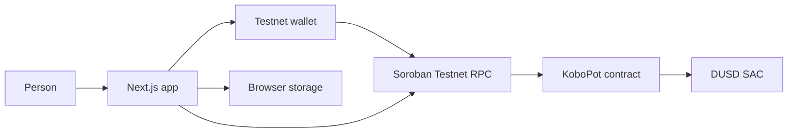

# Architecture

KoboPot splits a savings pot into on-chain custody and browser-only labels.

The contract stores the pot owner, token address, goal in DUSD base units, balance, deposit and withdrawal totals, contribution count, creation time, unlock time, and status. It also stores a per-owner nonce and the reference hashes it has already accepted.

The browser stores the goal name, category, note, saving rule, and simulated purchase history under `kobopot.pot-index.v1` and `kobopot.purchase-index.v1`. Those records are navigation aids. Balances shown after a wallet connects come from `get_pot`.

A contribution follows this path:

1. The form parses the simulated purchase into integer pesewas.
2. A fixed rule returns the configured saving. A round-up rule returns the amount needed to reach the next interval, or one full interval when the purchase is an exact multiple.
3. Pesewas convert to DUSD base units with `floor(pesewas * 10^decimals / ratePesewas)`.
4. The plain reference `KBP-YYYYMMDD-<uuid>` is hashed with SHA-256. Only the hash is submitted.
5. The wallet signs `contribute`. The contract transfers that exact token amount into its own address, then updates the pot.

Withdrawals require the supplied owner to match the stored owner and to authorize the call. A non-zero unlock time blocks withdrawal until ledger time passes it. Closing a pot is allowed only at a zero balance.

Public configuration is Testnet-only. Empty contract IDs mean the sandbox has not been pointed at a deployment. Explorer links must contain `/testnet`.
